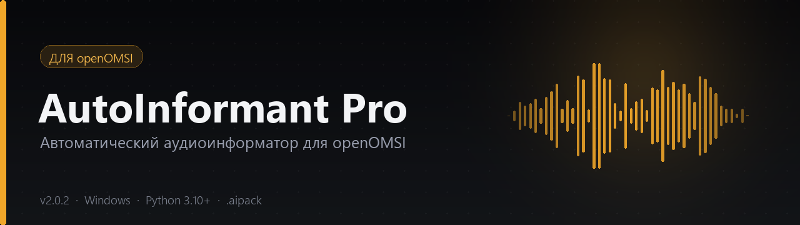
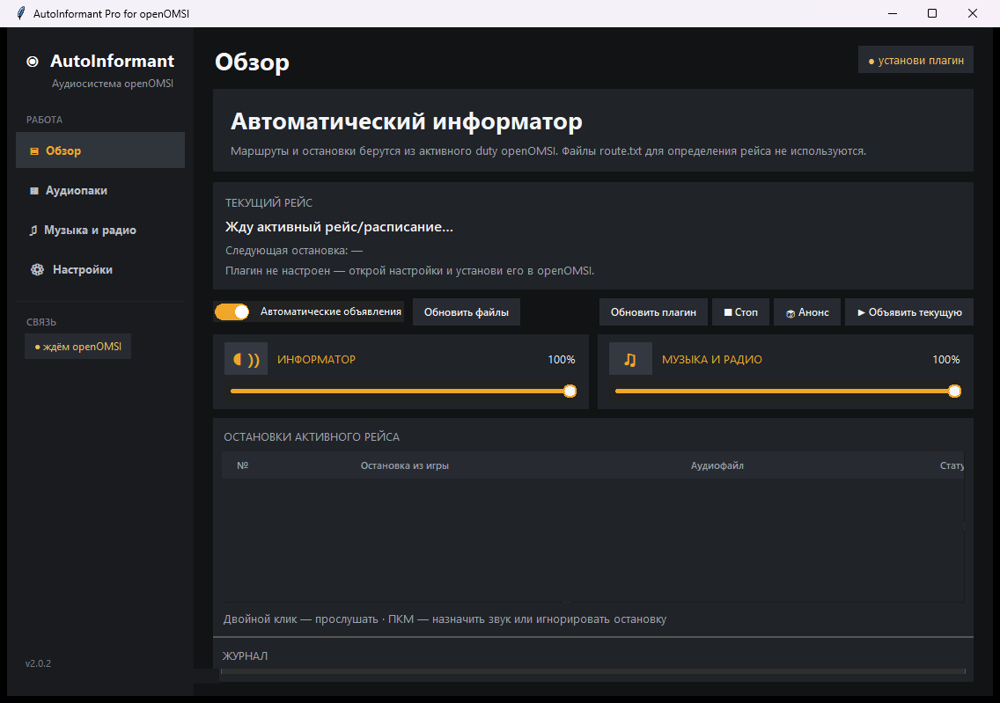
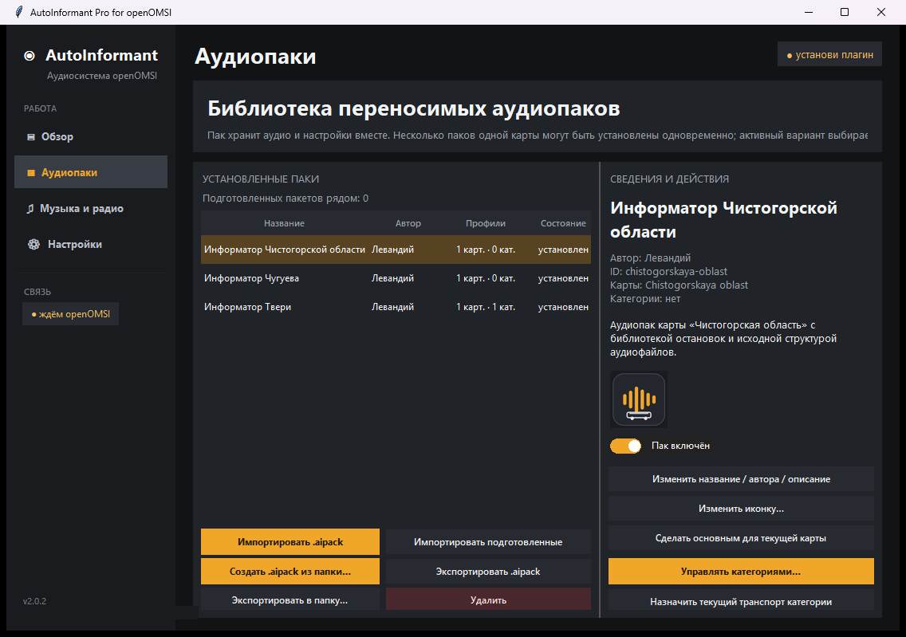
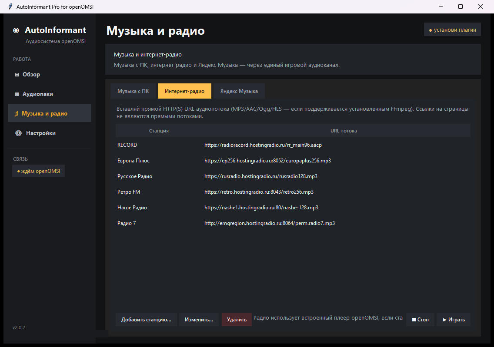
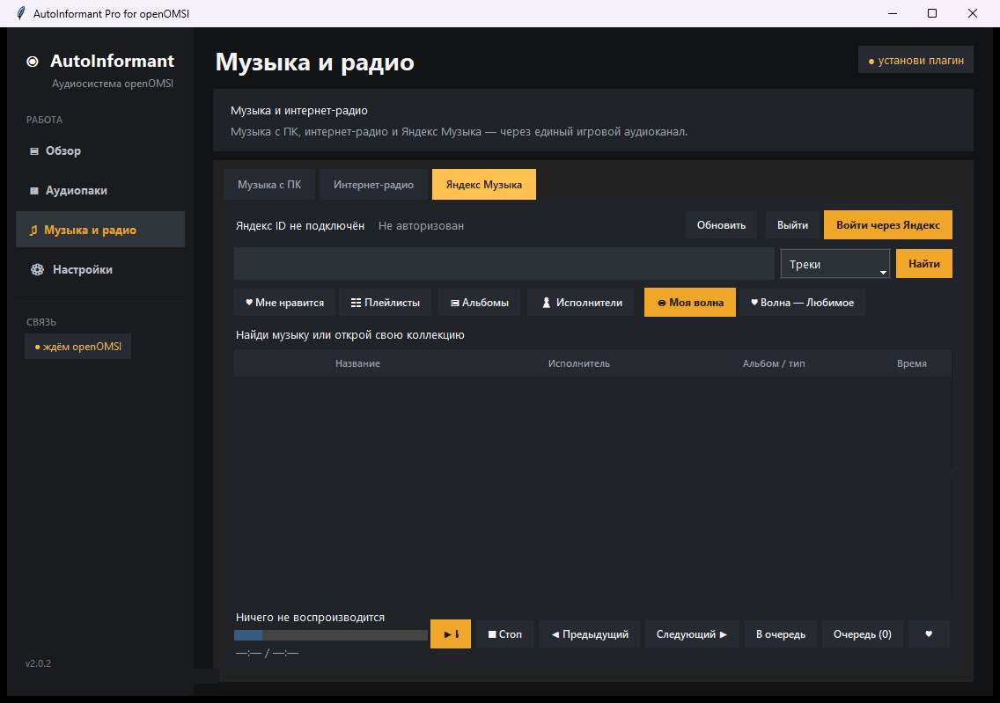

<p align="center">
  
</p>

<h1 align="center">AutoInformant Pro</h1>

<p align="center">
  Автоматический аудиоинформатор для <b>openOMSI</b>: объявляет остановки, конечные и время в пути,
  воспроизводит музыку, интернет-радио и Яндекс Музыку через игровой 3D-аудиоканал.
</p>

<p align="center">
  
  
  
  
  
</p>

<p align="center">
  <a href="https://github.com/Leva50305/autoinformant-pro/releases/latest"><b>Скачать</b></a> ·
  <a href="https://github.com/Leva50305/autoinformant-pro-audio-packs"><b>Аудиопаки</b></a> ·
  <a href="#быстрый-старт">Быстрый старт</a> ·
  <a href="CHANGELOG.md">Что нового</a> ·
  <a href="docs/DEVELOPMENT.md">Для разработчиков</a>
</p>

---

## Возможности

- **Автоматические объявления** по данным активного duty из openOMSI: прибытие, отправление, следующая остановка, конечная. Маршруты и остановки берутся из игры, а не из `route.txt`.
- **Гибкие сценарии**: радиусы срабатывания, ограничение скорости, префикс «Следующая остановка», анонсы по остановкам или по времени, расписания объявлений.
- **Переносимые аудиопаки `.aipack`**: звуки остановок, настройки профиля, назначения и расписания хранятся в одном файле. Несколько паков одной карты не затирают друг друга.
- **Категории транспорта** — отдельная аудиобиблиотека, которая полностью заменяет основной банк для назначенных моделей (например, «Троллейбусы» для Твери).
- **Назначение звука остановки прямо в пак**: выбрать файл из активного профиля или импортировать свой с компьютера.
- **Музыка и радио**: локальные файлы, интернет-радио и Яндекс Музыка с отдельным 3D-источником, микшером и регулировкой громкости.
- **Тёмный интерфейс** в стиле openOMSI: графит, оранжевые акценты, постоянно видимое меню.

## Скриншоты

| Обзор | Аудиопаки |
| :---: | :---: |
|  |  |

| Интернет-радио | Яндекс Музыка |
| :---: | :---: |
|  |  |

## Быстрый старт

### Готовая сборка (рекомендуется)

1. Скачайте `AutoInformantPro_Standalone_v2_0_2.zip` со страницы [**Releases**](https://github.com/Leva50305/autoinformant-pro/releases/latest).
2. Распакуйте архив в любую папку, например `C:\Games\AutoInformantPro`.
3. Запустите **`run_app.bat`** — при первом запуске он сам установит зависимости через `pip`.
4. Установите Lua-плагин: **Обзор → Обновить плагин** (или **Настройки → Плагин**), укажите папку `plugins` openOMSI и перезапустите игру.
5. Откройте **Аудиопаки → Импортировать .aipack** и выберите нужный пак из [репозитория аудиопаков](https://github.com/Leva50305/autoinformant-pro-audio-packs).
6. Запустите openOMSI, загрузите карту и duty — информатор подключится автоматически.

> **Важно:** не заменяйте `autoinformant_pro_settings.json` при обновлении — в нём хранятся ваши локальные настройки. В поставке этого файла намеренно нет.

### Запуск из исходников

```bat
git clone https://github.com/Leva50305/autoinformant-pro.git
cd autoinformant-pro
py -3 -m pip install -r requirements.txt
py -3 AutoInformant.py
```

Или просто запустите `run_app.bat` — он проверит и установит зависимости.

## Аудиопаки

<p align="center">
  <a href="https://github.com/Leva50305/autoinformant-pro-audio-packs">
    
  </a>
</p>

Готовые аудиотеки вынесены в отдельный репозиторий:
**[autoinformant-pro-audio-packs](https://github.com/Leva50305/autoinformant-pro-audio-packs)**

| Пак | Карта | Аудиофайлов | Размер |
| --- | --- | :---: | :---: |
| Информатор Твери | `Tver_2026` | 173 | 13,4 МБ |
| Информатор Чугуева | `Chuguev` | 73 | 2,2 МБ |
| Информатор Чистогорской области | `Chistogorskaya oblast` | 497 | 23,1 МБ |

Формат `.aipack` (schema v1) не требует распаковки: пак импортируется прямо из файла.

## Требования

| Компонент | Версия |
| --- | --- |
| Windows | 10 / 11 (64-bit) |
| Python | 3.10+ (проверено на 3.14) |
| openOMSI | сборка с Lua-плагин API |
| FFmpeg | ставится автоматически через `imageio-ffmpeg` |

Зависимости Python: `pygame-ce`, `mutagen`, `psutil`, `imageio-ffmpeg`, `ttkbootstrap`, `Pillow`, `yandex-music`.

## Структура проекта

| Файл | Назначение |
| --- | --- |
| `AutoInformant.py` | главное окно, вкладки, логика объявлений |
| `informant_core.py` | библиотека аудио, остановки, расписания |
| `pack_system.py` | импорт, экспорт и установка `.aipack` |
| `openomsi_bridge.py` | UDP/Lua-мост с openOMSI |
| `yandex_music_service.py` | адаптер Яндекс Музыки и FFmpeg-сегменты |
| `BusStopMaker.pyw` | утилита подготовки остановок |
| `plugin/AutoInformantPro/main.lua` | Lua-плагин для openOMSI |
| `run_app.bat` | запуск и автоустановка зависимостей |
| `docs/` | заметки о релизах и разработке |

## Тесты

```bat
py -3 -m unittest -q test_autoinformant.py test_yandex_music.py
```

Полный набор — **95 тестов**. Подробности и результаты проверок — в [`TEST_REPORT_RU.txt`](TEST_REPORT_RU.txt).

## Документация

- [История изменений](CHANGELOG.md)
- [Подробные заметки о версиях](docs/RELEASE_NOTES_RU.md)
- [Разработка и тесты](docs/DEVELOPMENT.md)
- [Сторонние компоненты](THIRD_PARTY_NOTICES.txt)

## Лицензия

Код распространяется по лицензии **MIT** — см. [LICENSE](LICENSE).

Проект не связан с Яндексом и не является официальным приложением Яндекс Музыки. Интеграция использует неофициальную библиотеку [`yandex-music`](https://github.com/MarshalX/yandex-music-api) и ваш собственный аккаунт. Товарные знаки принадлежат их владельцам.
